## Задание 1

[Диаграмма контейнеров CinemaAbyss](diagrams/container/CinemaAbyss_Container.puml)

## Задание 2

### 1. Proxy
Реализован [прокси-сервис](src/microservices/proxy) (API Gateway) на Java. Механизм маршрутизации работает по стратегии "Случайного распределения" с указанием вероятности попадания на сервис `movies`.

При установке `MOVIES_MIGRATION_PERCENT` в 0, все запросы маршрутизируются на legacy сервис `monolith`.

При установке `MOVIES_MIGRATION_PERCENT` в 100, все запросы маршрутизируются на новый микросервис сервис `movies`.

### 2. Kafka

Реализован [сервис событий](src/microservices/events) на Java.

- **Скриншот успешного выполнения тестов**: 

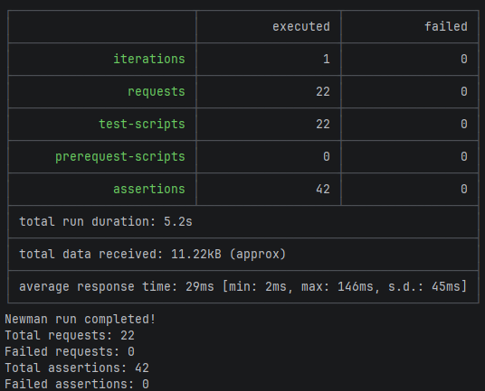

- **Скриншоты состояния топиков Kafka**:
  - Общее состояние топиков:

    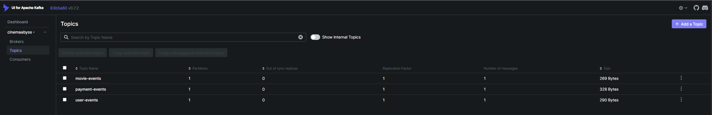
  - Сообщение в топике movie-events:

    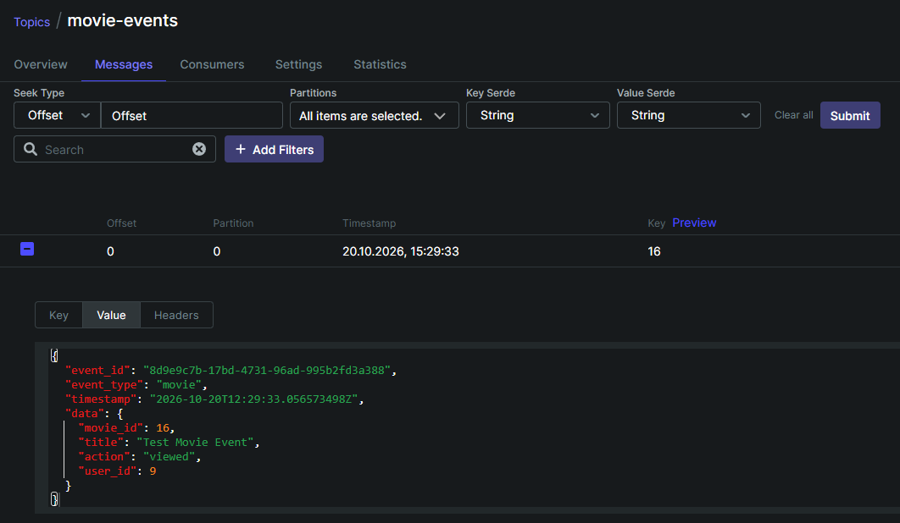

  - Сообщение в топике payment-events:

    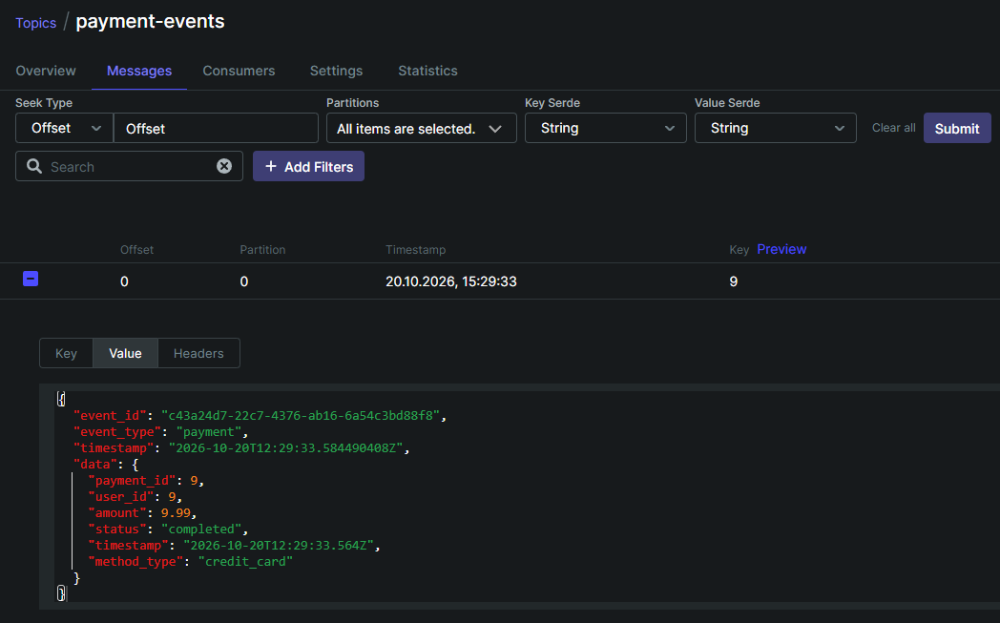

  - Сообщение в топике user-events:

    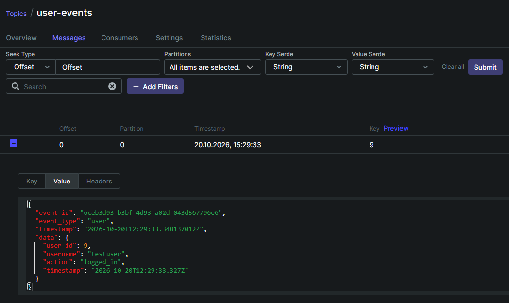

## Задание 3

### CI/CD

**Скриншот успешной сборки и тестов:**

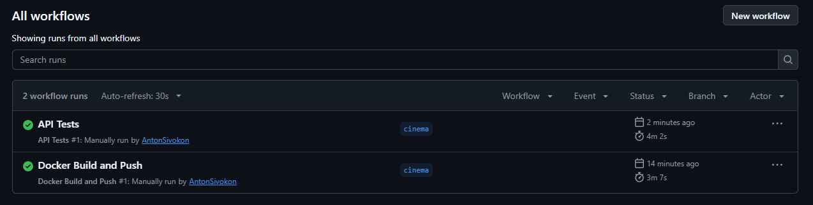

### Proxy в Kubernetes

**Скриншот вызова https://cinemaabyss.example.com/api/movies:**

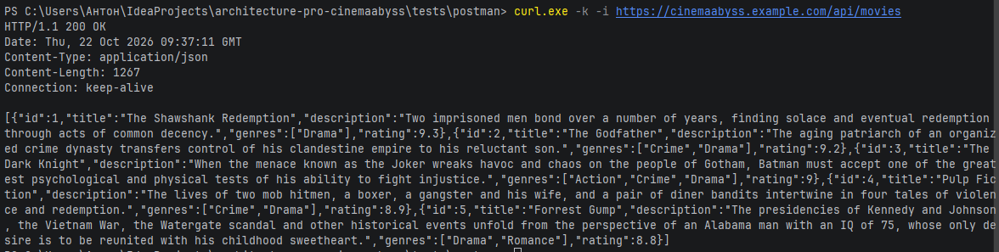

**Скриншот выполнения тестов:**

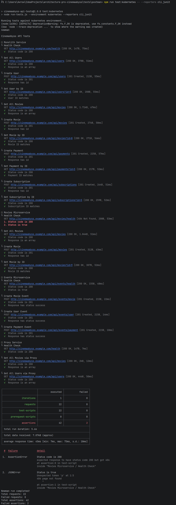

**Скриншот работы events-service после тестов:**

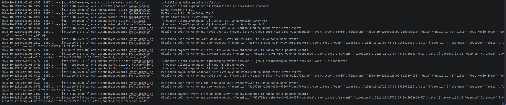

## Задание 4

**Скриншот развертывания helm:**

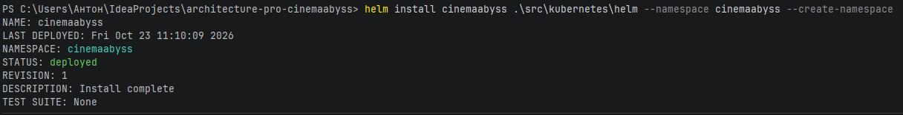

**Скриншот вывода https://cinemaabyss.example.com/api/movies:**

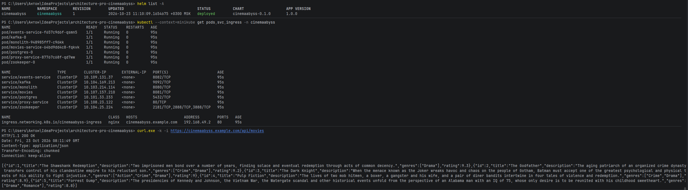

# Задание 5

**Скриншот работы circuit breaker:**

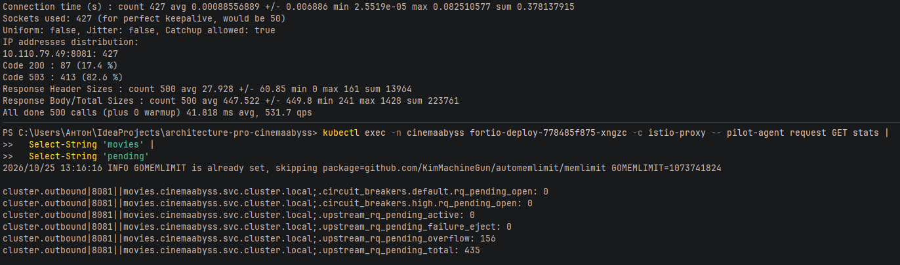